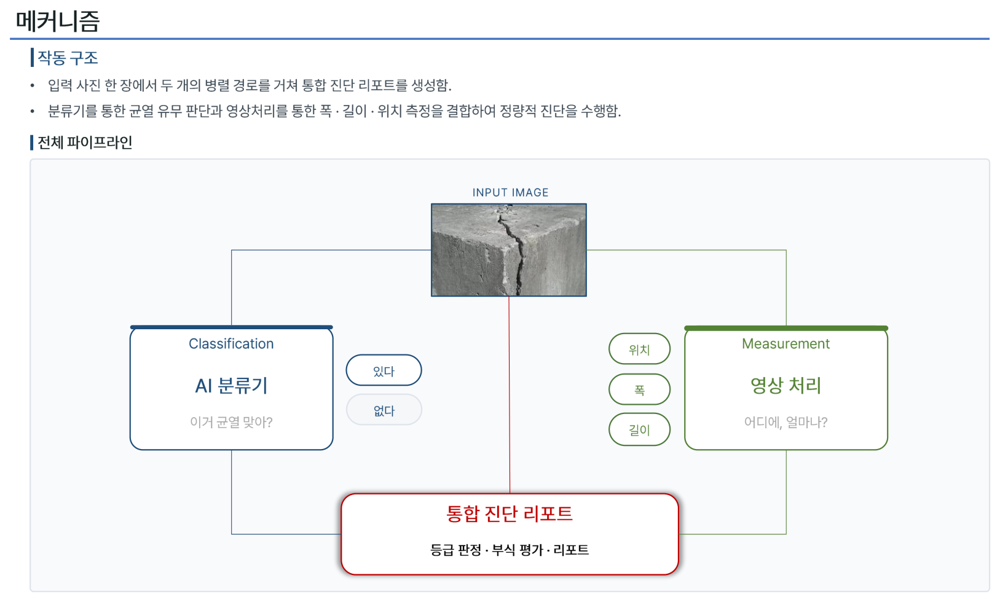
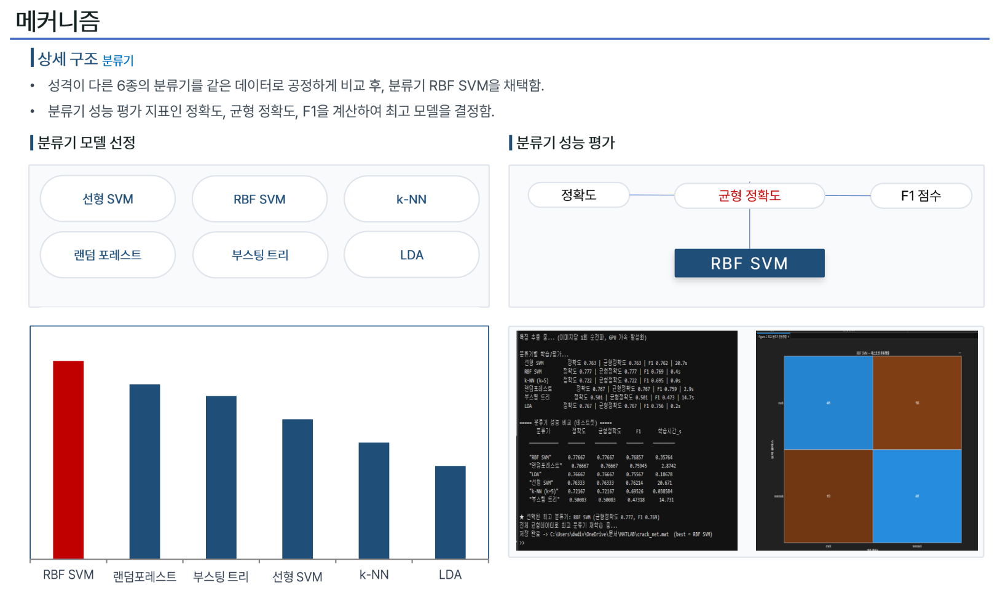
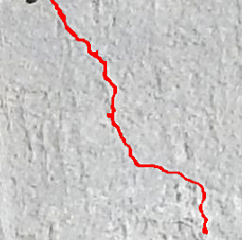
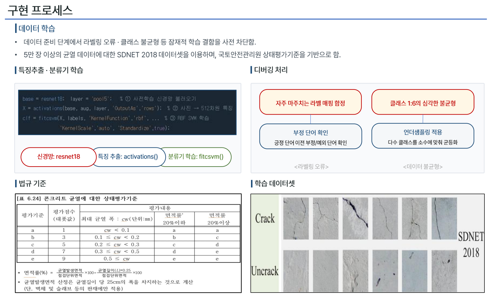
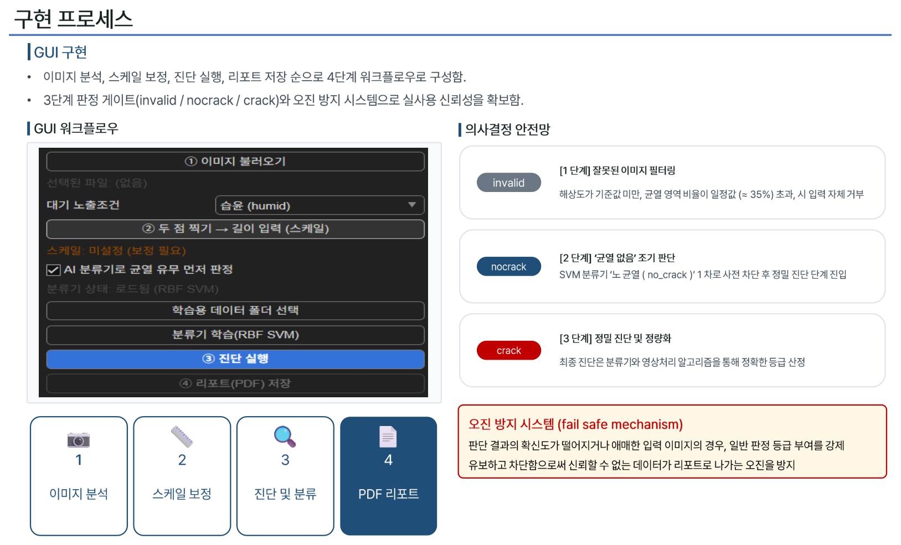
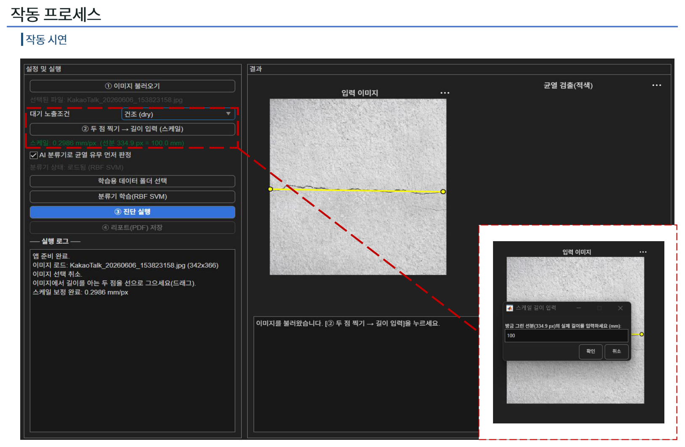
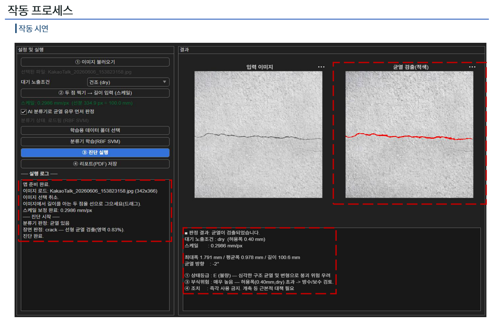
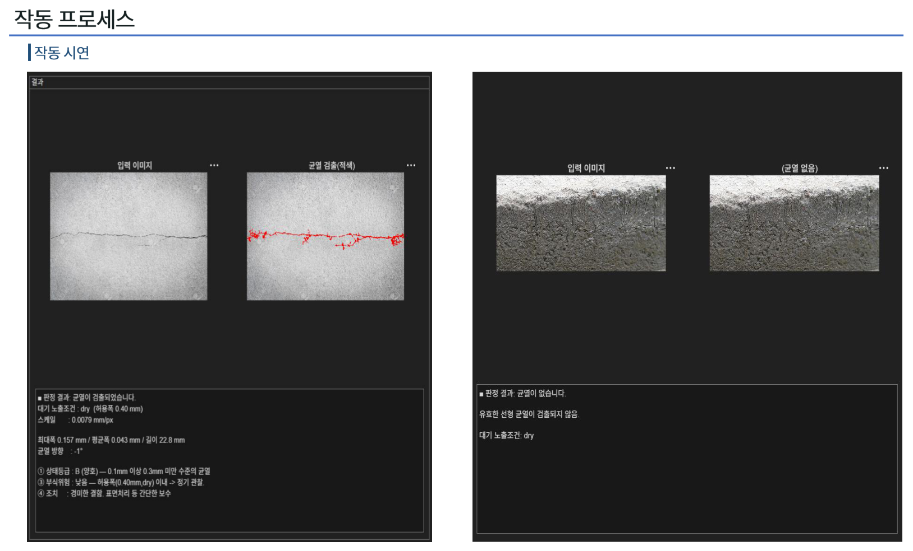

# 콘크리트 균열 진단 · 안전성 평가 시스템

**사진 한 장으로 콘크리트 균열의 유무 판정 → 영역 검출 → 폭·길이 측정 → 상태등급(A~E)·부식 위험 판정 → PDF 리포트까지 자동 수행하는 MATLAB 통합 진단 시스템**

> *Concrete Crack Diagnosis & Safety Assessment from a Single Image — a MATLAB pipeline that combines transfer-learning classification (ResNet-18 + RBF SVM) with morphology-based crack measurement, and grades structural condition (A–E) against Korean national inspection standards.*

<p>
  
  
  
</p>


---

## 개발 배경

2026년 5월 26일, 1966년에 지어져 약 60년 된 **서소문고가도로가 철거 작업 중 붕괴해 3명이 사망하고 3명이 부상**했습니다. 이 고가도로는 2019년 박락 사고 당시 이미 콘크리트 탈락과 철근 부식이 확인되며 노후화 대책 논의가 이어지던 구조물이었습니다. 위험 신호는 없었던 것이 아니라 **이미 데이터로 존재했지만, 점검하고 판단하는 속도와 일관성이 노후화 속도를 따라가지 못했습니다.**

현행 균열 점검은 (1) 점검자의 **육안·수기 측정에 의존**해 시점·각도·조명에 좌우되고, (2) 같은 균열도 사람마다 **판단이 엇갈리며**, (3) 구조물 수 대비 **인력이 부족**합니다. 이 프로젝트는 *"누구나 사진 한 장으로, 객관적이고 반복 가능하게 1차 진단할 수 있다면"* 이라는 문제의식에서 출발했습니다.

---

## 개요 — 두 개의 경로가 하는 일

사진 한 장이 입력되면 **서로 다른 두 경로가 각각 다른 질문에 답하고**, 그 결과를 합쳐 하나의 진단 리포트를 만듭니다.

**분류 경로 — "이 사진에 균열이 있는가?"**
AI(ResNet-18 + RBF SVM)가 사진 전체를 보고 균열 유무를 **있다/없다로 판정**합니다. 균열이 어디에 얼마나 있는지는 알려주지 않고, 오직 균열인지 아닌지만 판단합니다. 이 판정은 뒤에서 설명할 안전망의 1차 관문 역할을 합니다.

**측정 경로 — "그 균열이 어디에, 얼마나 있는가?"**
영상처리가 사진에서 균열 영역을 화소 단위로 찾아내고, 그 **폭·길이·방향을 실제 mm 단위로 측정**합니다. 다만 사진만으로는 "1픽셀이 몇 mm인지" 알 수 없기 때문에, GUI에서 사용자가 **길이를 아는 두 점을 선으로 긋고 그 실제 길이(mm)를 입력**하는 스케일 보정 단계를 두었습니다. 이 값이 있어야 픽셀 측정치가 물리 단위로 환산되어 등급 판정에 쓰일 수 있습니다.

**왜 둘 다 필요한가.**
AI는 균열 여부 판단에는 강하지만 정확한 치수를 재지 못하고, 영상처리는 치수는 정밀하게 재지만 콘크리트 표면의 거친 텍스처를 균열로 오인할 수 있습니다. 두 경로를 병렬로 두고 결과를 결합하면 한쪽의 약점을 다른 쪽이 보완합니다. 최종 등급은 측정 경로가 산출한 **최대 균열폭**을 국가 기준표와 대조해 결정됩니다.



**6단계 파이프라인:** ① 균열 유무 판정(AI) → ② 균열 영역 검출(영상처리) → ③ 폭·길이 측정(mm) → ④ 상태등급 판정(A~E) → ⑤ 부식 위험 평가 → ⑥ PDF 리포트 자동 생성

---

## 핵심 기능

- **균열 유무 판정** — 전이학습(ResNet-18) 특징 + RBF SVM 분류기
- **선형 균열 검출** — 표면 텍스처·얼룩 노이즈를 제거하고 가늘고 긴 선형 균열만 분리
- **폭·길이·방향 측정(mm)** — 스켈레톤·거리변환 기반 측정 + 두 점 스케일 보정
- **상태등급 A~E 판정** — 국토안전관리원 상태평가기준 기반, 사선(전단)균열 예외 규칙 포함
- **부식 위험 평가** — 대기 노출조건별 허용 균열폭(KDS 14 20 30) 대비 위험도 산정
- **오진 방지 안전망** — `invalid / nocrack / crack` 3단계 판정 게이트
- **PDF 리포트 자동 생성** 및 **MATLAB App GUI**

---

## 시스템 구조

### 1. AI 분류 경로 — 6종 분류기 공정 비교 후 최적 모델 선정

사전학습된 ResNet-18을 **특징 추출기로 고정**해 이미지당 512차원 특징(pool5)을 한 번만 뽑고, 그 위에서 성격이 다른 6종 분류기를 **동일 데이터·동일 분할(홀드아웃 30%)** 로 비교했습니다. 클래스 불균형(균열:비균열 ≈ 1:6)은 1:1 언더샘플링으로 보정했고, 불균형에 강한 **균형정확도(balanced accuracy)** 를 우선 지표로 삼았습니다. 이 "특징 추출 + 가벼운 분류기" 설계는 신경망 전체를 재학습(파인튜닝)하지 않으므로 **GPU 없이 일반 노트북(CPU)에서도** 빠르게 학습됩니다.



| 분류기 | 정확도 | 균형정확도 | F1 | 학습시간(s) |
|---|---|---|---|---|
| **RBF SVM ★** | **0.777** | **0.777** | **0.769** | 0.36 |
| 랜덤포레스트 | 0.767 | 0.767 | 0.759 | 2.87 |
| LDA | 0.767 | 0.767 | 0.756 | 0.19 |
| 선형 SVM | 0.763 | 0.763 | 0.762 | 20.67 |
| k-NN (k=5) | 0.722 | 0.722 | 0.695 | 0.06 |
| 부스팅 트리 | 0.580 | 0.500 | 0.473 | 14.73 |

→ **RBF SVM**이 균형정확도 0.777로 가장 우수하면서 학습시간도 0.36초로 짧아 최종 채택했습니다. 부스팅 트리는 균형정확도 0.500으로 사실상 한쪽으로 찍는 수준에 그쳤는데, 정확도(0.580)만 봤다면 놓쳤을 실패 신호입니다.

### 2. 영상처리 측정 경로 — 텍스처 노이즈를 이기는 선형 균열 검출

초기의 단순 이진화는 "어둡다"는 명암 정보만 사용해 **표면 텍스처·얼룩까지 균열로 오검출**했습니다. 핵심은 균열이 단지 어두운 것이 아니라 **가늘고 길게 이어진 선형 구조**라는 점입니다. 이를 (1) 전처리(흑백·미디언·샤프닝), (2) Bottom-hat 형태학 필터로 가늘고 어두운 선형 성분 강조, (3) **연결요소의 종횡비(≥4)와 길이(대각선의 15% 이상) 기준 형상 필터**의 3단계로 해결했습니다. 측정은 스켈레톤(중심선→길이)과 거리변환(중심선 거리×2→폭)으로 수행합니다.

<p align="center">
  
</p>

### 3. 상태등급 판정 기준

| 등급 | 최대 균열폭 cw (mm) | 상태 | 권장 조치 |
|---|---|---|---|
| A (우수) | cw < 0.10 | 미세 균열 | 지속 관찰 |
| B (양호) | 0.10 ≤ cw < 0.30 | 경미 | 표면처리 등 간단한 보수 |
| C (보통) | 0.30 ≤ cw < 0.50 | 보통 | 단면 복구·주입 보수 |
| D (미흡) | 0.50 ≤ cw < 1.00 | 내하력 저하 우려 | 긴급 보수·보강 |
| E (불량) | cw ≥ 1.00 | 붕괴 위험 우려 | 즉각 사용 금지 |

> **예외 규칙:** 균열 방향이 25°~65°인 **사선(전단) 균열**은 단순 건조수축이 아니라 하중을 견디지 못해 발생했을 가능성이 크므로, 폭과 무관하게 등급을 **최소 D로 상향**합니다.

부식 위험은 대기 노출조건별 허용 균열폭(KDS 14 20 30: dry 0.40 / humid 0.30 / corrosive 0.20 / severe 0.15 mm) 대비 실측 폭의 비율로 4단계(낮음/보통/높음/매우 높음) 산정합니다.



---

## GUI & 오진 방지 안전망

`① 이미지 → ② 스케일 보정(두 점 선분 → 실제 길이 입력) → ③ 진단 → ④ PDF 리포트`의 4단계 워크플로우입니다. 결과를 내기 전 3단계 판정 게이트로 신뢰할 수 없는 입력을 걸러냅니다: 해상도 미달이거나 검출 영역이 과도하면 **invalid(잘못된 이미지)**, 분류기가 '정상'으로 보거나 유효 균열이 없으면 **nocrack(균열 없음)**, 둘 다 통과해야 **crack**으로 정밀 진단합니다. 콘크리트 사진이 아닌데 "E등급"이 출력되는 것 자체가 심각한 오진이므로, 애매한 입력에는 **등급 부여를 아예 유보**하도록 설계했습니다.



---

## 작동 결과

**스케일 보정** — 길이를 아는 두 점을 선으로 긋고 실제 길이(mm)를 입력하면 mm/px 환산계수가 계산됩니다.



**사례 1 — 구조 균열(E등급):** 최대폭 1.791 mm / 길이 100.6 mm → 상태등급 E(불량), 부식 위험 "매우 높음".



**사례 2 — 미세균열(B등급) & 균열 없음:** 최대폭 0.157 mm → B(양호). 우측은 거친 표면이지만 형상 필터·판정 게이트가 오검출을 억제해 "균열 없음"으로 종료.



---

## 실행 방법

**요구 사항**
MATLAB (R2021b+), Image Processing Toolbox, Deep Learning Toolbox + ResNet-18 지원 패키지, Statistics and Machine Learning Toolbox

**1) 저장소를 내려받아 `src/` 폴더를 MATLAB 경로에 추가합니다.**

**2) 분류기 모델을 만듭니다.**
학습된 모델 파일(`crack_net.mat`)은 용량이 커서 저장소에 포함하지 않았습니다. 아래 중 한 가지 방법으로 생성하세요.

```matlab
% 방법 A — 학습 스크립트 실행 (권장)
% train_compare_classifiers.m 상단의 DATA_ROOT 를 SDNET2018 폴더 경로로 수정한 뒤 실행하면
% 6종 분류기를 비교하고 최고 모델을 crack_net.mat 으로 저장합니다.
train_compare_classifiers
```

```matlab
% 방법 B — 앱 안에서 바로 학습
% 앱 실행 후 [학습용 데이터 폴더 선택] → [분류기 학습(RBF SVM)] 버튼을 누르면
% 최적 모델(RBF SVM)만 빠르게 학습해 crack_net.mat 을 만듭니다.
```

생성된 `crack_net.mat`을 `crack_diagnosis_app.m`과 **같은 폴더**에 두면 앱이 시작할 때 자동으로 불러옵니다. 모델이 없어도 앱은 영상처리만으로 동작하며, 이 경우 AI 분류 단계만 건너뜁니다.

**3) 앱을 실행합니다.**

```matlab
crack_diagnosis_app
```

`samples/` 폴더의 이미지로 바로 테스트할 수 있습니다. 균열 사진 5장과 균열 없는 표면, 텍스처가 거친 표면이 들어 있습니다.

---

## 저장소 구조

```
concrete-crack-diagnosis/
├── src/
│   ├── crack_diagnosis_app.m         # 메인 GUI 앱 (진단 전체 파이프라인)
│   └── train_compare_classifiers.m   # 6종 분류기 비교·최적 모델 저장
├── docs/
│   ├── project_overview.md           # 프로젝트 종합 자료(배경·이론·구현·개발노트)
│   ├── final_report.pdf              # 최종 보고서
│   └── presentation.pdf              # 발표 자료
├── assets/                           # README용 그림
└── samples/                          # 테스트용 예시 이미지
```

> 학습된 모델(`crack_net.mat`)과 SDNET2018 원 데이터는 용량 문제로 저장소에 포함하지 않았습니다. 모델은 위 "실행 방법"의 두 가지 중 하나로 직접 생성할 수 있습니다.

---

## 기술적 한계 & 향후 과제

- **스케일 의존성** — 폭의 mm 환산이 사용자의 수동 두 점 보정에 의존 → 기준 마커·카메라 메타데이터 기반 자동 스케일링 검토
- **환경 변수 간섭** — 오염·그림자 시 일시적 노이즈 증가
- **표면 한정** — 사진 기반이라 내부 결함·깊이 진단 불가 → 비파괴검사 연계 검토
- **분류 구조** — 현재 "특징 추출 + 고전 분류기" 방식은 6종 공정 비교에 유리. 향후 ResNet-18 미세조정(fine-tuning) 모델과 동일 테스트셋에서 정량 비교 예정

> 개발 과정에서 마주친 문제와 해결(클래스 불균형, 학습·추론 전처리 불일치, 텍스처 오검출, 판정 게이트 설계 등)은 [docs/project_overview.md](docs/project_overview.md) §8에 자세히 정리했습니다.

---

## 데이터 & 근거

- **데이터셋:** SDNET2018 — 5만 장 이상의 콘크리트 표면 영상 (Dorafshan et al., 2018). *원 데이터는 저장소에 포함하지 않습니다.*
- **판정 기준:** 국토안전관리원(KISTEC) 시설물 상태평가기준, 콘크리트구조 설계기준 KDS 14 20 30 / KDS 41 30

> ⚠️ 본 시스템은 1차 스크리닝 보조 도구이며 현장 정밀점검을 대체하지 않습니다.

### 더 읽어보기
- 📄 [프로젝트 종합 자료](docs/project_overview.md) — 배경·이론·구현·개발노트 총정리
- 📄 [최종 보고서(PDF)](docs/final_report.pdf) · [발표 자료(PDF)](docs/presentation.pdf)

### 참고문헌
1. Dorafshan, S., Thomas, R. J., & Maguire, M. (2018). *SDNET2018: An annotated image dataset for non-contact concrete crack detection using deep convolutional neural networks.* Data in Brief, 21, 1664–1668.
2. 국토교통부, *콘크리트구조 설계기준 KDS 14 20 30(사용성) 및 KDS 41 30*, 국가건설기준센터.
3. 국토안전관리원, *시설물의 안전 및 유지관리 실시 세부지침* — 콘크리트 균열 상태평가기준.

---

서울대학교 건축전산 팀 프로젝트로 제작한 학술 결과물입니다. 사용 언어: **MATLAB**.
